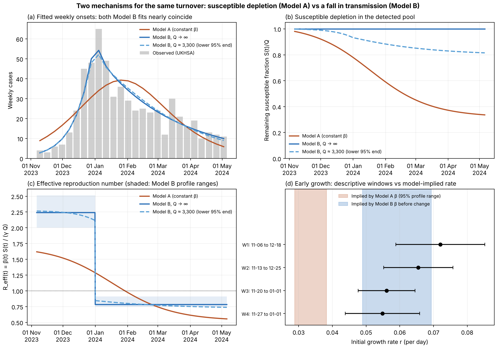

# Change-point transmission and parameter identifiability in an SEIR model of the 2023–2024 West Midlands measles outbreak

[](https://doi.org/10.5281/zenodo.24560052)

**Paul Adeyemi** · Retrospective mathematical epidemiology study · UK Health Security Agency surveillance data · November 2026

This study assesses whether a simple SEIR compartmental model can describe the 2023–2024 West Midlands measles outbreak. It compares a constant-transmission baseline with a piecewise-constant transmission model (the same SEIR equations with one change in $\beta(t)$) fitted to **26 consecutive observed onset weeks (6 November 2023–29 April 2024)**. The analysis examines early growth, the invasion threshold, model adequacy, structural and practical identifiability (profile likelihood, independently verified), the epidemic mechanism each model uses, and sensitivity to compartment timings.

**[Read the research report (PDF)](report/west_midlands_measles_research_report.pdf)** · [Editable manuscript](report/west_midlands_measles_research_report.md)

## Main findings

- **Fit.** Over 26 onset weeks, a one-change SEIR model fits much better than constant transmission (in-sample RMSE 5.32 vs 10.60 cases/week). The 1 January change date was chosen after seeing the peak, so this is a retrospective, descriptive comparison.
- **Mechanism.** The two models turn the epidemic over in different ways. Constant transmission must deplete about two-thirds of its detected susceptible pool, and its fitted β implies early growth (≈0.034/day) slower than every descriptive growth estimate (0.044–0.085/day). The one-change model reproduces the early growth (≈0.059/day) and attributes the turnover to a fall in the model's effective reproduction number from ≈2.2 to ≈0.78 (nominal range 0.75–0.91). This holds across four biological-timing scenarios.
- **Identifiability.** Only `Q = ρM` (detected pool) is visible to the data: ρ and M are structurally non-identifiable. Under constant transmission `Q` has a finite profile range (828–1,044). Under one change it has only a lower bound (≈3,300), confirmed against the exact `Q → ∞` limit, so depletion is at most about one-fifth of the detected pool. The transmission coefficients are well determined.
- **Change time.** Profiling the change date gives a minimum near 29 December 2023 and a nominal likelihood range of 23 December – 3 January: late December to early January, not a particular week, and not evidence of an intervention.
- **Verification.** Every interval endpoint was reproduced by an independent cold-start search and by a separate RK4 + Nelder–Mead implementation (agreement within 0.03%).

All results are conditional on fixed stage durations, the σE onset proxy, a closed homogeneous population and a Poisson likelihood. Fitted population-scale parameters are **not** the West Midlands population, and the model cannot say *why* transmission fell.



## Research materials

| Path | Contents |
|---|---|
| `report/` | Research report (PDF and Markdown source) |
| `data/` | UKHSA raw all-age weekly extract; weekly series with the missing 23 October 2023 observation marked missing |
| `analysis/` | Early growth, model comparison, timing sensitivity, profile likelihood, two independent verifications, mechanism analysis |
| `results/` | Archived fitted trajectories and numerical summaries |
| `figures/` | Selected epidemiological and model-diagnostic figures |
| `docs/` | Reproducibility, provenance and modelling qualifications |

## Reproduce the fits

Python 3.10+ is recommended (tested with Python 3.13, NumPy 2.5, SciPy 1.18, pandas 3.0, matplotlib 3.11, statsmodels 0.15).

```bash
python3 -m venv .venv
source .venv/bin/activate
python -m pip install -r requirements.txt
python analysis/00_observed_early_growth.py
python analysis/01_seir_model_comparison.py
python analysis/02_biological_timing_sensitivity.py
python analysis/03_profile_likelihood.py   # ~50 min
python analysis/04_verify_endpoints.py     # ~40 min
python analysis/05_rk4_crosscheck.py       # ~2 min
python analysis/06_mechanism_analysis.py   # <1 min
```

Scripts 00–03 read `data/observed_weekly_cases_with_missingness.csv` and write their outputs into `analysis/` (git-ignored), for comparison with the archived copies in `results/` and `figures/`. Scripts 04–06 read the archived results and write directly to `results/` and `figures/`. Optimizer solutions may differ slightly across dependency versions. All fits use the uninterrupted 26-week window, so the missing 23 October 2023 row is never imputed.

Identifiability, mechanism and verification results are summarised in [PROFILE_LIKELIHOOD_FINDINGS.md](PROFILE_LIKELIHOOD_FINDINGS.md).

For full methods, see [reproducibility details](docs/REPRODUCIBILITY.md) and [source provenance](docs/DATA_SOURCES.md).

## Interpretation

UKHSA data are observed laboratory-confirmed onset-week counts. Model curves are fitted **predictions**, not observed infections. The observation proxy, unknown reporting fraction, structural mixing-pool ambiguity and outcome-informed change date limit epidemiological interpretation. The observed-case fit does not, by itself, identify a causal intervention or the true susceptible population.

## Citation

If you use this work, please cite it as below (also available via GitHub's *Cite this repository* button, generated from `CITATION.cff`):

> Adeyemi, P. (2026). *Change-point transmission and parameter identifiability in an SEIR model of the 2023–2024 West Midlands measles outbreak* (Version 1.0.0) [Research report and code]. Zenodo. https://doi.org/10.5281/zenodo.24560052

## Licence

- **Code** (`analysis/`): MIT Licence, see [LICENSE](LICENSE).
- **Report, figures and documentation**: [Creative Commons Attribution 4.0 (CC BY 4.0)](https://creativecommons.org/licenses/by/4.0/).
- **UKHSA data** (`data/`): Contains public sector information licensed under the [Open Government Licence v3.0](https://www.nationalarchives.gov.uk/doc/open-government-licence/version/3/). © Crown copyright. See [docs/DATA_SOURCES.md](docs/DATA_SOURCES.md) for the full attribution.
