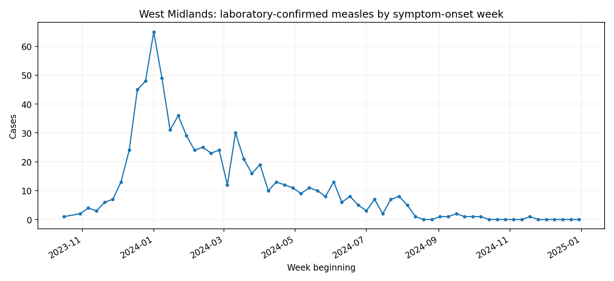
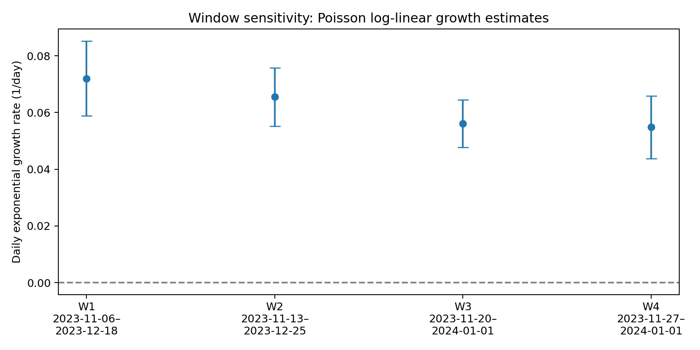
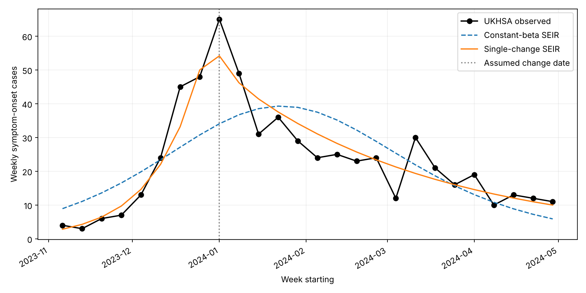
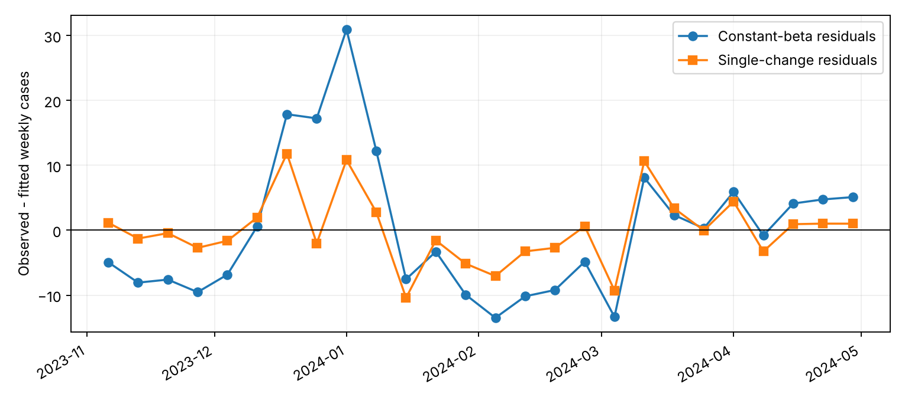
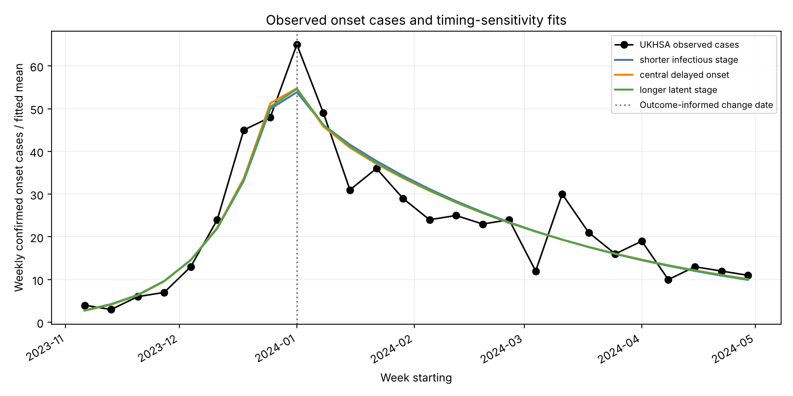

# Change-Point Transmission and Parameter Identifiability in an SEIR Model of the 2023–2024 West Midlands Measles Outbreak

## A retrospective analysis using observed regional surveillance cases

**Paul Adeyemi** · *Research report · November 2026*

## Abstract

Weekly laboratory-confirmed measles onset counts from the UK Health Security Agency were used to examine a 2023–2024 outbreak in the West Midlands, England. A closed susceptible–exposed–infectious–removed (SEIR) model was fitted under two transmission specifications: a constant coefficient and a single piecewise-constant change. The study combines disease-free stability analysis, early-growth estimates, retrospective model comparison, and structural and practical identifiability analysis using Poisson profile likelihoods.

Over 26 observed weeks (6 November 2023–29 April 2024), the fixed-date one-change specification reduced the in-sample root mean squared error from 10.60 to 5.32 cases per week. The two specifications explain the same epidemic turnover by different mechanisms. The constant-transmission fit can turn the epidemic over only by depleting about two-thirds of its detected susceptible pool. Its fitted transmission coefficient implies an initial growth rate of about 0.034 day$^{-1}$, below every confidence interval of the descriptive early-growth estimates (combined span 0.044–0.085 day$^{-1}$). The one-change fit reproduces the early growth (0.059 day$^{-1}$) and attributes the turnover to a fall in transmission, with the model's effective reproduction number moving from about 2.2 to about 0.78 (nominal range 0.75–0.91). Profile likelihoods show that the composite detected population scale $Q=\rho M$ has a finite profile range under the constant model but only a lower bound (about 3,300) under the change-point model, so depletion there is limited to at most about one-fifth of the detected pool. A refined change-time profile favours approximately 29 December 2023, with a nominal likelihood range of 23 December to 3 January. All interval endpoints were reproduced by an independent cold-start search and by a separate fourth-order Runge–Kutta and Nelder–Mead implementation.

These results are conditional on fixed stage durations, entry into infectiousness as a proxy for symptom onset, a closed homogeneous population and a Poisson likelihood. They concern model fit, mechanism and parameter constraints, not confirmed intervention timing, causal effects or uniquely recovered biological rates. The distinction between model adequacy, structural ambiguity and practical identification is central to the interpretation.

## 1. Introduction and research question

The motivating question is: How adequately can a simple deterministic SEIR model describe the rise and decline of observed measles onset-week cases in the West Midlands, and what changes when a single piecewise-constant transmission parameter is added?

This question is narrower than regional epidemic forecasting. The study examines a recorded outbreak retrospectively; it does not claim to reconstruct unobserved infection chains, assign interventions, or estimate the true susceptible share of every West Midlands resident.

The primary objectives are to (i) document and validate the surveillance observations; (ii) derive the SEIR conservation, positivity and invasion relationships; (iii) estimate descriptive early growth over several plausible windows; (iv) compare constant- and piecewise-transmission SEIR fits; (v) assess biological-timing assumptions and both structural and practical identifiability; and (vi) determine which epidemic mechanism, susceptible depletion or a change in transmission, each fitted specification uses to reproduce the turnover, and whether that mechanism is consistent with the observed early growth.

Interpretation of the fitted parameters is conditional on the observation mechanism and the retrospectively chosen change date.

### 1.1 Previous research and rationale

Compartmental epidemic models represent the movement of individuals between epidemiological states. The classical epidemic theory of Kermack and McKendrick (1927), together with later treatments by Anderson and May (1991) and Vynnycky and White (2010), motivates the use of a susceptible, exposed, infectious and removed population model. The exposed compartment is useful for measles because infection and infectiousness do not begin simultaneously. The resulting differential equations are a deliberately parsimonious approximation to a much more heterogeneous population.

Two published investigations are especially important for understanding the **actual 2023–2024 outbreak**. Jary et al. (2025) examined 406 confirmed measles cases in Birmingham between October 2023 and April 2024. They documented strong variation by vaccination status and sociodemographic characteristics, including the concentration of cases in underserved communities. Their findings caution against interpreting a one-population mixing coefficient as a uniform regional contact rate. The present work does not reproduce their age-specific or deprivation analyses; it uses a wider West Midlands onset-week series to study a different question: how a low-dimensional mechanistic model fits an aggregate epidemic curve.

Tang et al. (2025) investigated case-reporting delays and nowcasting for the England-wide 2023–2024 outbreak, including regional trends. Their work is directly relevant to our observation process: a laboratory-confirmed onset-week series is subject to delays and possible later revisions, and an epidemic model's predicted infections are not directly observed case notifications. Rather than building a nowcasting model, the present analysis fixes a retrospective observation snapshot and examines the fit and limitations of two SEIR transmission specifications.

Theoretical interpretation follows the next-generation approach to epidemic reproduction numbers described by Diekmann, Heesterbeek and Roberts (2010). A reproduction threshold in a compartmental model is conditional on model structure and susceptible composition. Cori et al. (2013) likewise demonstrate the dependence of epidemic transmissibility estimates on assumptions about incidence and the infectiousness profile. Consequently, the growth estimates below are treated as descriptive properties of the reported-case curve, not direct measurements of a unique reproduction number.

Finally, Chowell (2017) emphasizes the importance of observation error, parameter uncertainty and identifiability when calibrating dynamic models. Evans et al. (2005) provide further context for structural identifiability in epidemic systems. These considerations motivate our assessment of the scale–ascertainment ambiguity and residual variation, rather than simply choosing the fitted curve with the lowest error. CDC clinical guidance indicates that measles infectiousness can precede rash onset (CDC, *Pink Book*, Chapter 13); this is the biological reason the transition into the SEIR infectious compartment cannot be identified mechanically with reported symptom-onset cases.

## 2. Data and epidemiological context

The UKHSA metric measles_cases_casesByOnsetWeek counts weekly laboratory-confirmed measles cases by the reported date of rash or other symptom onset, stratified by UKHSA region and age group. The working extraction is restricted to all-age, all-sex West Midlands regional observations, preventing aggregation across overlapping age strata.

The audited study-period file contains 63 reported rows over 64 expected weekly slots from October 2023 through December 2024. A record for the week beginning 23 October 2023 was absent; this is not an observed zero and was not imputed. The consecutive fitting interval 6 November 2023–29 April 2024 excludes this ambiguity.

The full audited 2023–2024 extract sums to 714 cases over its observed rows; the 2024 onset-week records sum to 561. The dataset peak occurs during the week beginning 1 January 2024 at 65 observed cases. These figures should not be conflated with outbreak notifications compiled using different extraction dates or onset/reporting definitions.

Because revisions and reporting delays can affect source data, the archived raw extract, extraction date, metric definition, and filters must remain attached to any reproducible project release. The manuscript reports only quantities previously computed from the audited snapshot.

### 2.1 Regional population and vaccination context

Official ONS mid-year population estimates used in the audit are 6,105,177 (2023) and 6,181,633 (2024) for the West Midlands statistical region. These are regional population denominators, not estimates of the population participating in the epidemic transmission network.

The audit compared local-authority coverage between the UKHSA West Midlands region and ONS West Midlands. The geography codes are not identical, so the boundary correspondence should be documented explicitly rather than assumed from a shared name.

For context, regional uptake estimates in the NHS England West Midlands MMR toolkit (2023, quarter 3) reported July–September 2023 coverage of 89.5% for MMR dose one by age two, 92.7% for dose one by age five, and 83.4% for dose two by age five; Birmingham figures were 81.3%, 87.4% and 74.5%, respectively. These are age- and cohort-specific measures and cannot be inserted as the immune fraction of the all-age regional population.

Population and vaccination indicators motivate the biological setting; they do not identify model susceptibility or vaccination effects from the regional weekly confirmed-case series. No causal vaccination effect is estimated in this report.

## 3. Mathematical model and analysis

We use the conventional **susceptible–exposed–infectious–removed (SEIR)** classification. The removed class $R(t)$ consists of individuals who have left the transmission process and are no longer susceptible within the model. In a simplified measles model, this class is interpreted mainly as individuals recovered with acquired immunity. **Removed** is the more general mathematical term: in other epidemic models it may include isolation or disease-related death, depending on the formulation. We do not model these pathways separately and do not interpret $R(t)$ as observed recoveries.

Let $S(t)$, $E(t)$, $I(t)$ and $R(t)$ be the compartment populations at time $t$, with an effective mixing population $M>0$. The initial states are nonnegative and satisfy $S(0)+E(0)+I(0)+R(0)=M$. Under homogeneous mixing and a closed population, the model is

$$
\begin{aligned}
\frac{dS}{dt} &= -\beta(t)\frac{SI}{M}, \\
\frac{dE}{dt} &= \beta(t)\frac{SI}{M}-\sigma E, \\
\frac{dI}{dt} &= \sigma E-\gamma I, \\
\frac{dR}{dt} &= \gamma I.
\end{aligned}
$$

The force of infection on susceptibles is $\beta(t)I(t)/M$. The parameter $\sigma>0$ governs progression from exposed to infectious ($1/\sigma$ is the mean exposed-stage residence time under the exponential assumption), while $\gamma>0$ governs exit from the infectious class ($1/\gamma$ is the corresponding mean infectious-stage residence time). Their values are fixed within each fitting scenario. The effective transmission coefficient $\beta(t)$ is allowed to differ across the two competing models.

**Model A — constant-transmission SEIR.** The reference model assumes

$$
\beta_A(t)=\beta_0, \qquad t\geq 0.
$$

**Model B — single-change-point SEIR.** The alternative uses the *same four differential equations*, initial-condition assumptions and observation process, but permits one discontinuity in the transmission coefficient:

$$
\beta_B(t)=
\begin{cases}
\beta_1, & 0\leq t<t_c,\\
\beta_2, & t\geq t_c.
\end{cases}
$$

For the primary retrospective model comparison, $t_c$ is fixed at the week beginning **1 January 2024**, after inspection of the observed epidemic peak. A separate exploratory profile analysis subsequently allows $t_c$ to vary. In practical terms, we placed the bend in Model B at a date where we already knew the observed curve turned downward. This offers the more flexible model an advantage, so improved in-sample fit is a descriptive comparison, not independent discovery of a historical transmission switch. The coefficients $\beta_1$ and $\beta_2$ are estimated from the case series. Thus Model B is not a different compartmental model; it is a less restrictive *transmission-rate specification of the same SEIR system*. The data do not establish that any real intervention or abrupt behavioural change occurred at $t_c$.

Both systems omit age structure, migration, births, deaths, repeated introductions, and heterogeneous contact networks. The fitted effective mixing population $M$ should not be identified with the entire ONS West Midlands population.

### 3.1 Conservation and nonnegativity

Summing the four differential equations gives

$$
\frac{d}{dt}(S+E+I+R)=0,
\qquad S(t)+E(t)+I(t)+R(t)=M.
$$

Conservation is a property of the **closed mathematical model**, not an assertion that the actual region has no demographic changes. Solutions also remain nonnegative when initialized in the nonnegative orthant. On each coordinate boundary,

$$
\left.\frac{dS}{dt}\right|_{S=0}=0,\quad
\left.\frac{dE}{dt}\right|_{E=0}=\beta(t)\frac{SI}{M}\geq0,
$$

$$
\left.\frac{dI}{dt}\right|_{I=0}=\sigma E\geq0,\quad
\left.\frac{dR}{dt}\right|_{R=0}=\gamma I\geq0.
$$

These inward- or tangent-pointing vector-field conditions establish forward invariance of the biologically admissible region for nonnegative parameters. The same conservation and nonnegativity properties hold across the modelled transmission switch, provided the compartment states are continuous. Computational approximations should be checked for preservation of these properties.

### 3.2 Equilibria and invasion threshold

For a constant value of $\beta$, an equilibrium is defined by $dS/dt=dE/dt=dI/dt=dR/dt=0$. Since $\gamma>0$, the condition $dR/dt=\gamma I=0$ implies $I^*=0$; then $dI/dt=\sigma E=0$ implies $E^*=0$.

Thus the **disease-free equilibria** are

$$
\boxed{(S^*,E^*,I^*,R^*)=(S^*,0,0,M-S^*), \quad 0\leq S^*\leq M.}
$$

In particular, $I^*=0$ means that no infectious individuals remain at equilibrium. This closed SEIR system has a continuum of disease-free states, not a unique endemic equilibrium with $I^*>0$.

To examine invasion, linearize the infected variables $(E,I)$ about a disease-free state while holding its susceptible level $S^*$ fixed to first order:

$$
\frac{d}{dt}
\begin{pmatrix}E\\I\end{pmatrix}
=
\underbrace{\begin{pmatrix}
-\sigma & \beta S^*/M\\
\sigma & -\gamma
\end{pmatrix}}_{J_{\mathrm{inf}}}
\begin{pmatrix}E\\I\end{pmatrix}.
$$

The relevant trace and determinant are

$$
\operatorname{tr}(J_{\mathrm{inf}})=-(\sigma+\gamma)<0,
\qquad
\det(J_{\mathrm{inf}})=\sigma\gamma\left(1-\frac{\beta S^*}{\gamma M}\right).
$$

Defining the effective reproduction threshold

$$
\mathcal R_{\mathrm{eff}}=\frac{\beta S^*}{\gamma M},
$$

we obtain decay of sufficiently small infected perturbations for $\mathcal R_{\mathrm{eff}}<1$ and initial invasion when $\mathcal R_{\mathrm{eff}}>1$. For $\mathcal R_{\mathrm{eff}}=1$, a zero eigenvalue requires separate analysis. Since the complete system has a continuum of disease-free equilibria, the statement concerns stability **transverse to the disease-free manifold**, not asymptotic stability of an isolated four-dimensional equilibrium.

If the dominant linearized growth rate is $r$, the characteristic equation gives

$$
(r+\sigma)(r+\gamma)=\sigma\beta\frac{S^*}{M},
\qquad
\mathcal R_{\mathrm{eff}}=\left(1+\frac r\sigma\right)\left(1+\frac r\gamma\right).
$$

This relation is conditional on approximately constant susceptibility and specified biological stage durations. It is **not** used here to assert a uniquely identified regional reproduction number.

## 4. Observation model and estimation

To distinguish prevalence from incidence, introduce a cumulative transition count $C(t)$ satisfying

$$
\frac{dC}{dt}=\sigma E(t), \qquad
\mu_k=\rho\left[C(t_{k+1})-C(t_k)\right],
$$

where $\mu_k$ is the fitted mean of *reported new cases* during week $k$ and $0<\rho\leq1$ is a hypothetical ascertainment fraction. In particular, $I(t_k)$ is **infectious prevalence**, so it is not directly interchangeable with the observed weekly symptom-onset count $y_k$.

The transition $E\to I$ marks the onset of *infectiousness* in this SEIR formulation. UKHSA, however, records the week of **reported symptom onset**, not the first infectious day. A person with measles can become infectious before rash onset (CDC, *Pink Book*). Therefore the modelled quantity $\sigma E(t)$ is a convenient **incidence proxy**, not a measured onset rate. We do not compare $I(t)$ directly against weekly cases, since $I(t)$ represents prevalence rather than weekly new cases.

The sensitivity script varies stage durations and also evaluates the cumulative transition counter over weeks displaced by three days. This shift probes sensitivity to observation-clock alignment, but does not implement a clinical onset-delay distribution. In particular, it neither establishes a three-day biological lag nor reconstructs the dates of infection or symptom onset. A more elaborate model could represent expected symptom-onset incidence as a convolution of infection incidence with a clinically informed onset-delay distribution; that extension is outside the present study. The existing comparison is still meaningful as an *exploratory within-model fit comparison*, provided the resulting transmission coefficients and timing estimates are not interpreted as uniquely measured biological rates.

The fitted weekly counts are assumed conditionally independent Poisson observations. The Pearson dispersion of the constant-transmission fit is approximately 4.89, which signals considerable unexplained variation relative to the Poisson assumption. For the one-change fit it is approximately 1.24, close to Poisson. Section 5.2 therefore also reports quasi-likelihood ranges in which the likelihood-ratio threshold is multiplied by the Pearson dispersion. Model AIC values are useful descriptive comparisons within the assumed likelihood, not a substitute for model adequacy.

### 4.1 Descriptive growth analysis

The rising observed segment was analyzed using Poisson log-linear regressions, $\log\mathbb E[Y_k]=a+b t_k$, where $t_k$ is measured in weeks. The estimated daily growth rate is $r=b/7$ and, for $r>0$, the doubling time is $T_d=\log(2)/r$.

Four partially overlapping windows produce daily growth estimates of approximately 0.0720, 0.0655, 0.0561 and 0.0549, corresponding to doubling times of about 9.6, 10.6, 12.4 and 12.6 days. These are descriptive rates for reported onset-week cases, not direct biological transmission coefficients.

The dependence on window selection shows that a single exponential trend is not equally representative throughout the early outbreak. The windows overlap and were selected retrospectively; their robust Wald intervals are conditional on this procedure, and do not capture all reporting and biological uncertainty.

We do not reinterpret these fitted growth rates as population reproduction numbers without independent assumptions about generation-interval structure and observation delays.

### 4.2 Calibration and model comparison

Both models were fitted to the same 26 consecutive onset weeks, 6 November 2023 to 29 April 2024. The constant model estimates three parameters and the change-point model estimates four. Other biological timing assumptions were held fixed within each paired comparison.

Fits minimized independent Poisson negative log-likelihood (NLL) over log-transformed parameters within the bounds $\beta\in[0.03,2]$ day$^{-1}$, $Q\in[30,10^7]$ and $J_0=\rho I(0)\in[0.01,1000]$; the initial exposed count is set from the initial-growth eigenvector. The system was integrated with SciPy LSODA (relative tolerance $10^{-8}$). Every fit, including the timing-sensitivity fits, used bounded L-BFGS-B optimization from a grid of 24 (constant model) or 48 (change-point model) starting points spanning small and large detected pools; the number of starts reaching the best value is archived with each fit. The fitting objective emphasizes agreement with observed onset-week counts, not mechanistic recovery of all epidemiological quantities.

Diagnostic statistics include weekly-case root mean squared error (RMSE), Poisson deviance and AIC. AIC differences are conditional on the shared, potentially misspecified likelihood; they must not be interpreted as a probability that a model is true.

A six-week temporal holdout (fitting the first 20 weeks and predicting the last 6) gave RMSE 2.90 for the change-point model and 9.12 for the constant model. However, the change date was selected after inspection of the complete epidemic curve (including the future portion), and the held-out period lies after the observed peak. This is not an unbiased assessment of out-of-sample model selection. It is reported as an exploratory internal diagnostic only.

## 5. Results and discussion

The constant-transmission SEIR fit yields RMSE 10.60 weekly cases, Poisson deviance 109.93 and AIC 239.24. The one-change alternative yields RMSE 5.32, Poisson deviance 27.11 and AIC 158.43. The relative RMSE decrease is about 49.8%.

The observed peak occurred in the week beginning 1 January 2024. The constant-transmission curve places its predicted peak on 22 January; the change-point curve places it on 1 January. This is an in-sample outcome, and the change date itself was selected with knowledge of that observed peak.

The comparison supports the limited statement that, under these model and likelihood assumptions, a single additional time-varying transmission parameter improves retrospective description of this outbreak. It does not demonstrate a true intervention effect or a uniquely identified regional transmission history.

Changes in clustered exposure, surveillance, introductions, immune composition or population contact patterns could yield similar deviations from the one-group, constant-transmission approximation.

### 5.1 Residual patterns and model adequacy

Residuals in the constant-transmission fit display substantial systematic discrepancies, particularly around the observed outbreak peak. The change-point fit reduces several large residuals but does not eliminate the week-to-week variability or establish correct mechanistic specification.

The fitting evidence is also conditioned on fixed exponential compartment durations and the proxy symptom-onset process. The dataset is a sequence of laboratory-confirmed cases, and fluctuating observation probability or reporting completeness can contribute to model residuals.

For these reasons the main comparison is framed as a model-adequacy exercise rather than inference about a particular source of outbreak control.

### 5.2 Structural and practical identifiability

Parameter identifiability concerns what features of the transmission system are determined by the observation process, rather than merely which parameter values an optimizer returns. We distinguish an exact **structural** ambiguity from the **practical** constraints imposed by finite, noisy case observations.

**Structural ambiguity of ascertainment and population scale.** With weekly expected counts

$$
\mu_k=\rho\int_{t_k}^{t_{k+1}}\sigma E(t)\,dt,
$$

the SEIR equations are invariant under the population rescaling

$$
(S,E,I,R,M,\rho)\longmapsto(cS,cE,cI,cR,cM,\rho/c),
$$

for positive $c$ such that the transformed ascertainment fraction remains admissible. In particular,

$$
\widetilde{\mu}_k=\frac{\rho}{c}\int_{t_k}^{t_{k+1}}\sigma cE(t)\,dt=\mu_k.
$$

Thus ideal observations of this kind cannot separately identify the effective mixing-pool size $M$ and ascertainment $\rho$ without external information. The fitting code is parameterized in detected units, including $Q=\rho M$ and $J_0=\rho I(0)$. This structural scaling symmetry does **not** imply that the composite $Q$ must itself be practically unidentifiable in every transmission specification.

**Conditional profile-likelihood analysis.** For a parameter $\psi$ and nuisance vector $\eta$, define its negative-log-likelihood profile as

$$
\ell_p(\psi)=\min_{\eta}\ell(\psi,\eta),
\qquad
\Delta\ell_p(\psi)=\ell_p(\psi)-\ell_{\min}.
$$

At each fixed $\psi$, the remaining parameters are optimized rather than held at their joint-fit values. The archived profiles use independent Poisson weekly counts and the same fixed rates $\sigma=0.1$ day$^{-1}$ and $\gamma=1/7$ day$^{-1}$ as the primary comparison. The continuous-parameter profiles for Model B condition on a change date of 1 January 2024; the change-time profile is a **separate** analysis in which the date varies and the other parameters are refitted.

The following are *nominal* profile-likelihood regions determined by $\Delta\ell_p\leq1.9207$ (one degree of freedom on the negative-log-likelihood scale). The quasi-likelihood column multiplies this threshold by the Pearson dispersion of the corresponding model (4.89 for constant transmission, 1.24 for one change).

| Model and quantity | Profile region | Quasi-likelihood region | Interpretation |
|:--|:--|:--|:--|
| Constant transmission: $Q$ | 828–1,044 | 728–1,243 | Localized composite scale, but poor model adequacy |
| Constant transmission: $\beta_0$ | 0.221–0.251 day$^{-1}$ | 0.203–0.269 day$^{-1}$ | Localized, conditional on an inadequate model |
| One change: $Q$ | 3,305 to **no finite upper end** | 2,841 to no finite upper end | Only a lower bound; profile flat toward $Q\to\infty$ |
| One change: $\beta_1$ (before) | 0.286–0.359 day$^{-1}$ | 0.282–0.364 day$^{-1}$ | Localized, conditional on fixed date and stages |
| One change: $\beta_2$ (after) | 0.107–0.130 day$^{-1}$ | 0.106–0.134 day$^{-1}$ | Localized, conditional on fixed date and stages |
| One change: change time $t_c$ | 23 Dec 2023 – 3 Jan 2024 | about the same | Approximate only (nonregular; see below) |

For the one-change fit with the date fixed at 1 January, the optimum at the imposed finite search bound $Q=10^7$ has negative log-likelihood approximately 75.21449. A separately optimized no-susceptible-depletion limit as $Q\to\infty$, in which the model becomes a linear SEIR system with the same transmission coefficients, gives approximately **75.21405**, slightly better. The limiting likelihood is therefore the appropriate reference for that model's population-scale profile, and its upper likelihood threshold is never crossed. The open interval is a property of the data and model, not of the search box. The computed lower endpoint, around $Q=3{,}305$, is not an estimate of the actual West Midlands population.

The more flexible transmission model fits the observed cases better while constraining $Q$ less well. Conversely, the constant-transmission model gives a narrowly localized $Q$ profile despite its evident residual discrepancies. A narrow profile under a poorly fitting model should not be confused with reliable biological estimation. For the one-change model the quasi-likelihood regions are barely wider than the likelihood regions, because its residual variation is close to Poisson.

**Change time.** A separate profile over the change time $t_c$ (all other parameters refitted at each $t_c$) has its lowest negative log-likelihood at approximately **29 December 2023** (day 53.2 of the fitting window). The 1 January fixed-date fit is about 0.38 negative-log-likelihood units higher, and a change on 25 December fits almost as well as one on 1 January. The data therefore point to late December or early January, not to a particular week. The range within 1.92 units of the minimum runs from **23 December 2023 to 3 January 2024**. This is a descriptive likelihood region, **not a calibrated 95% confidence interval**. Change-point inference is nonregular, the date was investigated after observing the epidemic curve, and the observation model is simplified. A secondary local minimum in March lies about 18.5 units above the global minimum and is not supported. Neither the estimated date nor the better fit identifies an intervention.

**Numerical verification and inferential limits.** The profiles were computed by warm-started outward walks with forward and backward sweeps, Brent root-finding at the threshold crossings, and projected-gradient convergence diagnostics. Two further checks were made.

- *Independent cold-start search.* Every finite endpoint was re-evaluated at the endpoint and just inside and outside it. Each evaluation used 80 Latin-hypercube starts over the full search box, with no information from the original profiles. All 11 endpoints were reproduced; the largest change among the transmission and scale endpoints was 0.03%. This check also found that the original change-time profile, computed on a 2-day grid, had placed the minimum on 30 December. A continuous search moved it to 29 December and the interval endpoints by 0.03 days.
- *Separate re-implementation.* The SEIR model, observation proxy and likelihood were re-coded with a hand-written fixed-step classical fourth-order Runge–Kutta integrator. Optimization used derivative-free Nelder–Mead from both the original solutions and fresh random starts. At identical parameters the two integrators agree to within $3\times10^{-6}$ in negative log-likelihood, and halving the Runge–Kutta step changes it by less than $10^{-8}$. Re-optimized in this implementation, every endpoint sits at the threshold to within 0.03% (0.008 days for the change time), and the fresh random starts alone reached the same optima.

These are checks of the numerical procedure, not independent validation of the epidemic mechanism. The usual $\chi^2$ cutoff is only nominal here. Overdispersion in the constant model, parameter bounds, the large-$Q$ limit, a simplified symptom-onset proxy and nonregular change-point estimation all prevent treating these regions as fully calibrated 95% epidemiological confidence intervals. A more realistic observation model would be needed for that claim.

{width=100%}

### 5.3 Two mechanisms for the same turnover

A closed SEIR epidemic can stop growing for two reasons. The susceptible pool can be depleted until $\mathcal R_{\mathrm{eff}}=\beta S/(\gamma M)$ falls below one, or transmission itself can fall. The two specifications use different mechanisms, and the profile results above make the difference quantitative. Figure 6 shows both fitted solutions in terms of the threshold quantity of Section 3.2. It includes the one-change fit both in its $Q\to\infty$ limit and at its lower profile endpoint $Q\approx3{,}305$.

**Constant transmission: turnover by depletion.** With $\beta$ fixed, the only way the fitted epidemic can peak and decline is through falling $S$. The fit places $Q\approx925$ against 600 observed cases in the window, so about 66% of the detected pool is infected by the end of April. In the model, $\mathcal R_{\mathrm{eff}}(t)$ declines smoothly from about 1.62 and crosses one at the end of January. The cost of this mechanism appears in early growth. Substituting the fitted $\beta_0$ into the characteristic equation $(r+\sigma)(r+\gamma)=\sigma\beta S(0)/M$ with $S(0)/M\approx1$ gives an initial growth rate of about 0.034 day$^{-1}$ (profile range 0.029–0.038 day$^{-1}$), a doubling time of about three weeks. The descriptive Poisson growth windows of Section 4.1 estimate 0.055–0.072 day$^{-1}$, and none of their confidence intervals (combined span 0.044–0.085 day$^{-1}$) overlaps the model-implied range. With constant transmission, the fit cannot reproduce both the steep early rise and the timing of the turnover. It settles on a compromise that grows too slowly at first and peaks three weeks late (Figure 3).

**One change: turnover by reduced transmission.** In the one-change fit the profile for $Q$ has only a lower bound. Even at that bound ($Q\approx3{,}305$) the detected pool is depleted by about 18% by the end of the window, and in the $Q\to\infty$ limit not at all. The two fits produce weekly curves that differ by at most 2.1 cases (Figure 6a). This is a direct picture of the practical non-identifiability of $Q$: very different amounts of depletion are compatible with the same data. What the data do determine is the transmission change. With $S/M\approx1$, the model's effective reproduction number is about **2.24** before the change (nominal profile range 2.00–2.52) and about **0.78** after it (0.75–0.91), a ratio of about 0.35. The implied initial growth rate, 0.059 day$^{-1}$ (range 0.049–0.069 day$^{-1}$), overlaps the confidence interval of every descriptive growth window. Across the four biological-timing scenarios of Section 5.4, the post-change value ranges from 0.76 to 0.82 and the pre-change value from 1.99 to 2.43, with the implied growth rate between 0.059 and 0.060 day$^{-1}$.

**What this does and does not show.** Under the stated assumptions, the case counts favour a turnover produced by a fall in effective transmission to below the threshold, rather than by exhaustion of the susceptible pool. The early-growth comparison uses the same observations and retrospectively chosen windows, so it is a check of internal consistency, not independent validation. The reproduction numbers are model quantities for a homogeneous, detected-unit approximation. They depend on the fixed stage durations, and they are not estimates of the basic reproduction number of measles, which is far higher in a fully susceptible population. A pre-change value near 2 is what one would expect from transmission concentrated in a partly immune population, consistent with the concentration of Birmingham cases in under-vaccinated communities reported by Jary et al. (2025). The model cannot say *why* transmission fell: vaccination catch-up, public-health response, school holidays, behavioural change and depletion within unmodelled high-risk subgroups are all compatible with a homogeneous-model "fall in $\beta$". In particular, strong depletion confined to a small, highly connected subpopulation would look like a fall in transmission in a one-group model. Distinguishing these explanations requires heterogeneous or age-structured models and external data.

![Two mechanisms for the same turnover. (a) Observed weekly onsets with the constant-transmission fit and two one-change fits whose detected pools differ by more than three orders of magnitude. (b) Remaining susceptible fraction of the detected pool. (c) Model effective reproduction number $\mathcal R_{\mathrm{eff}}(t)=\beta(t)S(t)/(\gamma Q)$; shading shows the one-change profile ranges. (d) Descriptive early-growth estimates (points, 95% robust intervals) against the initial growth rates implied by each model's fitted transmission coefficient.](../figures/mechanism_depletion_vs_transmission.png){width=100%}

### 5.4 Biological-timing sensitivity

The timing robustness check considered four assignments for the exponential E/I stages and onset proxy: historical 10/7 days with zero lag; 8/6 days with three-day lag; 9/8 days with three-day lag; and 11/8 days with three-day lag. The durations are sensitivity inputs informed broadly by clinical time scales, not measured SEIR rates uniquely implied by CDC sources.

Across these scenarios constant-model RMSE ranges from 10.50 to 10.64; the one-change RMSE ranges from 5.17 to 5.38 weekly cases. The relative ranking persists within this finite grid of assumptions, and the AIC advantage of the one-change model is at least 80 units in every scenario. In every scenario the one-change fit places $Q$ at the upper search bound, consistent with the flat $Q$ profile of Section 5.2.

The result is a robustness statement limited to these four illustrative numerical timing scenarios. The implementation shifts integration/output times rather than using a calibrated symptom-onset kernel; the altered timing cannot be read as clinically verified. This analysis is not evidence that natural-history parameters have been identified from surveillance counts. The timing-sensitivity script uses a looser integration tolerance than the primary analysis. Its historical-scenario constant fit agrees with the primary fit to within 0.006 negative-log-likelihood units.

### 5.5 Interpretation in context

The study demonstrates a productive distinction between mathematical and empirical conclusions. Conservation and infection-subsystem linear stability are established from the differential equations; early-growth rates are descriptive regression findings; numerical fit rankings are retrospective comparisons; and disease-mechanism explanations remain uncertain.

The strongest empirical result is not only that a single-change SEIR trajectory matches the observed case series better *in sample*. The two fitted specifications also rest on different mechanisms, and only the change-in-transmission mechanism is consistent with the observed early growth. This conclusion is conditional on the retrospective choice of change date and on the model structure. Its limitations are equally substantive: outcome-informed switching, a crude observation map, overdispersion in the constant model, homogeneous mixing, uncertain immunity, incomplete ascertainment information, structural scale non-identifiability, and the absence of an upper bound on $Q$ under the change-point model.

Vaccination-coverage data provide essential background but do not identify vaccination effectiveness or the all-age susceptible fraction from the current aggregate series. Likewise ONS population is an appropriate demographic denominator but is not interchangeable with the fitted effective mixing pool.

Published Birmingham and England-wide studies provide essential context. The present analysis is distinguished by its comparison of two parsimonious mechanistic specifications on the regional onset-week series, by its separation of structural from practical identifiability, and by numerical results reproduced through two independent implementations.

## 6. Conclusion

A parsimonious SEIR model provides a useful mathematical description of regional measles onset-week counts, but descriptive fit is not equivalent to identifying a biological transmission history. Over the 26-week retrospective comparison, the one-change model fits the observed epidemic trajectory more closely than a constant-transmission baseline. When the change date is profiled rather than fixed after viewing the peak, the exploratory likelihood minimum lies near **29 December 2023**; the surrounding late-December/early-January region does not establish a unique date or a causal intervention.

The two specifications reproduce the turnover by different mechanisms. The constant-transmission fit relies on depleting about two-thirds of its detected susceptible pool, and its transmission coefficient implies early growth that is too slow for the observed rise. The one-change fit reproduces the early growth and attributes the turnover to a fall in the model's effective reproduction number from about 2.2 to about 0.78, below the invasion threshold, with depletion of at most about one-fifth of the detected pool. This conclusion survives the four biological-timing scenarios examined. It is a statement about which mechanism the aggregate data favour within a homogeneous SEIR model, not about the cause of the fall.

The mathematical and numerical identifiability results sharpen this interpretation. A structural scaling symmetry prevents separate recovery of case ascertainment and mixing-population size from the specified observations. Conditional Poisson likelihood profiles localize $Q$ in the less adequate constant-transmission model, but the one-change model permits the detected population scale to increase without reaching a finite upper profile limit. Transmission-coefficient profiles are localized only conditional on the fixed biological durations, observation approximation, and model specification. All reported interval endpoints were reproduced by an independent cold-start search and by a separate Runge–Kutta and Nelder–Mead implementation.

The accompanying repository retains the UKHSA extraction, cleaned observed series, analysis scripts (including both numerical verifications and the mechanism analysis), model outputs and a summary of the identifiability findings. The absent 23 October 2023 source record is not imputed. These results support a focused exercise in mathematical epidemiology and model criticism, not claims about true measles infection incidence, vaccination effects, or uniquely recovered regional parameters. Natural next steps are a clinically informed symptom-onset observation process, an overdispersed (negative binomial) count model, and a two-group or age-structured model that can test whether the apparent fall in transmission reflects depletion within a highly connected, under-vaccinated subpopulation.

## References and source data

Kermack, W. O. & McKendrick, A. G. (1927). A contribution to the mathematical theory of epidemics. Proceedings of the Royal Society A. https://doi.org/10.1098/rspa.1927.0118

Anderson, R. M. & May, R. M. (1991). *Infectious Diseases of Humans: Dynamics and Control.* Oxford University Press. https://doi.org/10.1093/oso/9780198545996.001.0001

Vynnycky, E. & White, R. G. (2010). *An Introduction to Infectious Disease Modelling.* Oxford University Press. ISBN 9780198565765.

Diekmann, O., Heesterbeek, J. A. P. & Roberts, M. G. (2010). The construction of next-generation matrices for compartmental epidemic models. Journal of the Royal Society Interface. https://doi.org/10.1098/rsif.2009.0386

Cori, A., Ferguson, N. M., Fraser, C. & Cauchemez, S. (2013). A new framework and software to estimate time-varying reproduction numbers during epidemics. American Journal of Epidemiology. https://doi.org/10.1093/aje/kwt133

Chowell, G. (2017). Fitting dynamic models to epidemic outbreaks with quantified uncertainty: A primer for parameter uncertainty, identifiability, and forecasts. *Infectious Disease Modelling*, 2(3), 379–398. https://doi.org/10.1016/j.idm.2017.08.001

Evans, N. D., White, L. J., Chapman, M. J., Godfrey, K. R. & Chappell, M. J. (2005). The structural identifiability of the susceptible infected recovered model with seasonal forcing. *Mathematical Biosciences*, 194(2), 175–197. https://doi.org/10.1016/j.mbs.2004.10.011

Jary, H. et al. (2025). Sociodemographic inequalities in the epidemiology and vaccine uptake within a large outbreak of measles in Birmingham, England, 2023 to 2024. Eurosurveillance 30(16). https://doi.org/10.2807/1560-7917.ES.2025.30.16.2400652

Tang, M. L. et al. (2025). Nowcasting cases and trends during the measles 2023/24 outbreak in England. Journal of Infection 91(3), 106569. https://doi.org/10.1016/j.jinf.2025.106569

CDC. Chapter 13: Measles. Pink Book. https://www.cdc.gov/pinkbook/hcp/table-of-contents/chapter-13-measles.html

CDC Center for Forecasting and Outbreak Analytics. (2026). Behind the model: Interactive measles outbreak simulator (staged exposure and infectiousness). https://www.cdc.gov/cfa-behind-the-model/php/data-research/interactive-measles-outbreak-simulator.html

UKHSA. Measles cases by week of symptom onset: metric definition. https://ukhsa-dashboard.data.gov.uk/metrics-documentation/measles-cases-by-week-of-symptom-onset

UKHSA. Measles data dashboard. https://ukhsa-dashboard.data.gov.uk/vaccine-preventable-diseases/measles

Office for National Statistics / Nomis. Mid-year population estimates, West Midlands, 2023–2024. https://www.nomisweb.co.uk/

NHS England, West Midlands Region (2023). *MMR uptake toolkit, July–September 2023*. Regional vaccine-coverage material; figures used here describe specified childhood cohorts. See the repository data-source notes for provenance and limitations.

